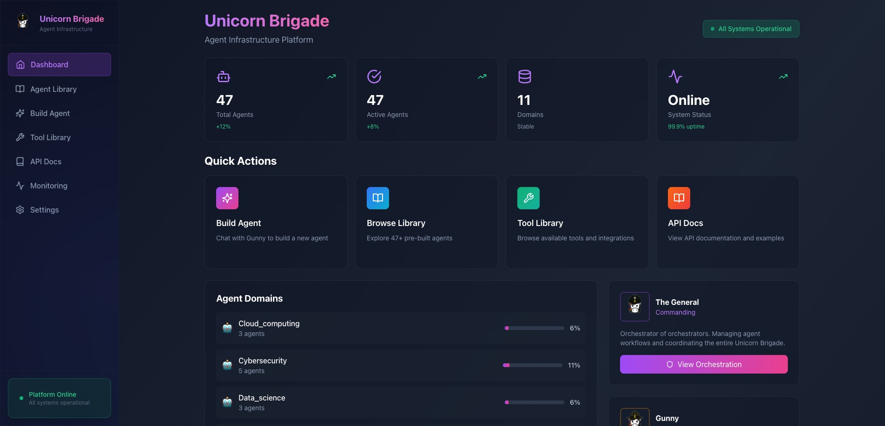
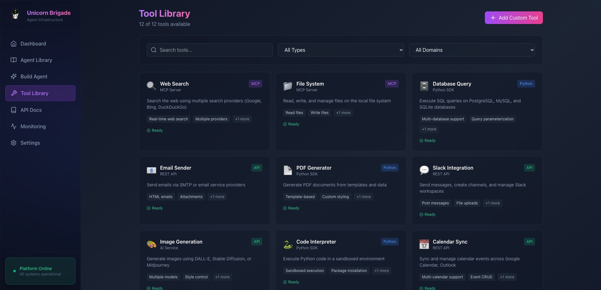
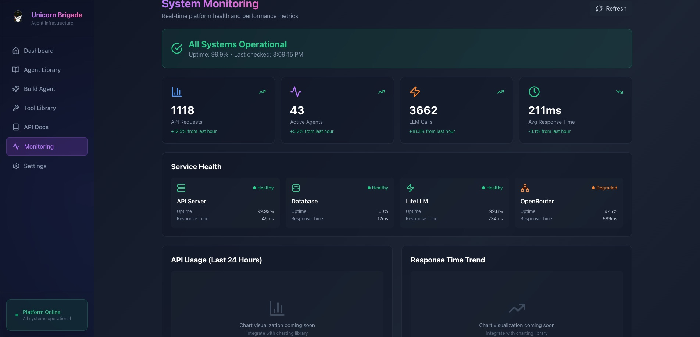

<div align="center">

# 🦄⚔️ Unicorn Brigade

### *Agent Infrastructure Platform*

**The Future of AI Agent Development and Orchestration**

[](https://opensource.org/licenses/MIT)
[](https://nodejs.org/)
[](https://reactjs.org/)
[](http://makeapullrequest.com)

**Part of [Magic Unicorn Unconventional Technology & Stuff Inc.](https://magicunicorn.tech)**  
Explore our product suite at [Unicorn Commander](https://unicorncommander.com)

</div>

---

## 📸 Screenshots

<div align="center">

### Dashboard


### Tool Library


### System Monitoring


</div>

---

## 🚀 What is Unicorn Brigade?

**Unicorn Brigade** is a comprehensive agent infrastructure platform that revolutionizes how you build, deploy, and orchestrate AI agents. As part of the **UC-Cloud ecosystem**, Brigade serves as the **"Agent Factory"** - where you build and manage AI agents that can be used across all UC-Cloud services.

Unlike simple agent builders, Unicorn Brigade provides a complete ecosystem for agent development with:

- 🎖️ **The General** - Orchestrator of orchestrators, managing agent workflows and coordinating your entire Brigade
- 🎯 **Gunny** - Your conversational Agent Builder who helps you create agents through natural dialogue
- 📚 **47+ Pre-built Agents** - Domain-specific agents ready to deploy across financial, legal, medical, cybersecurity, and more
- 🔧 **Extensible Tool System** - Integrate with APIs, databases, web search, code execution, and custom tools
- 🌐 **Multi-Provider LLM Support** - Works with OpenAI, Anthropic, Google, Meta, and 100+ models via LiteLLM
- 🔗 **A2A Protocol** - Linux Foundation's Agent-to-Agent communication standard
- 📊 **Built-in Monitoring** - Real-time system health, metrics, and performance tracking
- 🎨 **Beautiful UI** - Glass morphism design with purple/pink gradients

---

## 🎖️ Meet The Characters

### The General - Orchestrator of Orchestrators


**The General** is the strategic command center of Unicorn Brigade. He coordinates multi-agent workflows, manages complex orchestrations, and ensures your entire Brigade operates in perfect harmony. Think of him as the conductor of your AI symphony.

**Key Capabilities:**
- Multi-agent workflow orchestration
- Strategic coordination and planning
- Brigade-level management
- High-level decision making
- Resource allocation and optimization

<br clear="left"/>

### Gunny - Your Agent Builder


**Gunny** is your hands-on Agent Builder. Through natural conversation, he guides you through creating sophisticated AI agents tailored to your specific needs. No code required - just tell him what you want to build.

**Key Capabilities:**
- Conversational agent creation
- 4-phase build process (Discovery → Design → Review → Created)
- Real-time agent preview
- Tool recommendation and integration
- Domain expertise across all verticals

<br clear="left"/>

---

## ✨ Key Features

### 🤖 Agent Management
- **Browse 47+ Pre-built Agents** - Financial analysts, legal researchers, cybersecurity specialists, and more
- **Build Custom Agents** - Chat with Gunny to create agents through conversation
- **Agent Library** - Organized by domain with advanced filtering and search
- **Visual Architecture** - Interactive React Flow diagrams showing agent internals
- **Build History Timeline** - See how each agent was created

### 🔧 Tool Integration
- **12+ Built-in Tools** - Web Search, Database Query, Code Executor, File System, API Client
- **Tool Library** - Browse, search, and manage available tools
- **Drag-and-Drop Assignment** - Easily assign tools to agents
- **MCP Support** - Model Context Protocol for standardized tool integration
- **Custom Tools** - Create your own tools with simple configuration

### 🎨 Developer Experience
- **Interactive API Documentation** - Code examples in cURL, JavaScript, and Python
- **Agent Preferences** - Control model, temperature, max tokens, and more
- **Real-time Preview** - See your agent configuration as it's being built
- **System Monitoring** - Track API requests, LLM calls, response times
- **Enhanced Configuration** - Full LLM parameter control (top-p, penalties, stop sequences)

### 🔗 Interoperability
- **A2A Protocol** - Linux Foundation standard for agent-to-agent communication
- **Agent Cards** - Standardized agent metadata format
- **Multi-Provider** - OpenAI, Anthropic, Google, Ollama, and 100+ models via LiteLLM
- **RESTful API** - Comprehensive API for programmatic access
- **WebSocket Support** - Real-time updates and streaming responses

---

## 🏗️ Architecture

```
┌─────────────────────────────────────────────────────────────┐
│                      Unicorn Brigade                         │
│                   Agent Infrastructure                       │
└─────────────────────────────────────────────────────────────┘
                              │
                    ┌─────────┴─────────┐
                    │                   │
            ┌───────▼───────┐   ┌──────▼──────┐
            │  The General  │   │    Gunny     │
            │  Orchestrator │   │Agent Builder │
            └───────┬───────┘   └──────┬───────┘
                    │                   │
        ┌───────────┼───────────────────┼──────────┐
        │           │                   │          │
    ┌───▼───┐  ┌───▼───┐          ┌────▼────┐ ┌──▼───┐
    │Agent 1│  │Agent 2│   ...    │Agent 46 │ │Agent │
    │Financial│ │ Legal │          │Cyber Sec│ │  47  │
    └───┬───┘  └───┬───┘          └────┬────┘ └──┬───┘
        │          │                    │          │
        └──────────┴────────────────────┴──────────┘
                          │
                  ┌───────┴────────┐
                  │                │
            ┌─────▼─────┐    ┌────▼─────┐
            │   Tools    │    │   LLMs   │
            │ (12+ types)│    │(100+ models)│
            └────────────┘    └──────────┘
```

---

## 🛠️ Tech Stack

### Frontend
- **React 18.3** - Modern UI framework
- **Vite** - Lightning-fast build tool
- **Tailwind CSS** - Utility-first styling
- **React Flow** - Interactive node diagrams
- **React Router** - Client-side routing
- **Axios** - HTTP client
- **React Hot Toast** - Beautiful notifications
- **Lucide React** - Icon system

### Backend
- **Node.js 18+** - JavaScript runtime
- **Express.js** - Web framework
- **Prisma** - Next-generation ORM
- **SQLite** - Embedded database
- **LiteLLM** - Multi-provider LLM proxy
- **OpenRouter** - Access to 100+ models

### Infrastructure
- **A2A Protocol** - Agent-to-agent communication
- **Model Context Protocol (MCP)** - Standardized tool integration
- **RESTful API** - Complete programmatic access
- **WebSocket** - Real-time updates

---

## 📦 Installation

### Deployment Modes

Unicorn Brigade can be deployed in two ways:

#### **1. UC-Cloud Integration (Recommended - Production)**

Brigade is designed to integrate with the UC-Cloud ecosystem for production deployment.

**Prerequisites:**
- UC-Cloud infrastructure running (PostgreSQL, Redis, Keycloak, Traefik)
- Docker and Docker Compose installed

**Quick Start:**

\`\`\`bash
# Navigate to UC-Cloud directory
cd /path/to/UC-Cloud

# Build Brigade images
docker compose -f docker-compose.brigade.yml build

# Start Brigade services
docker compose -f docker-compose.brigade.yml up -d

# Initialize database
cd Unicorn-Brigade
npx prisma db push

# Verify deployment
docker ps | grep brigade
docker logs unicorn-brigade --tail 20
\`\`\`

**Access:**
- **Production**: https://brigade.unicorncommander.ai
- **Local**: http://localhost:8102

**See** [UC-CLOUD-INTEGRATION.md](./UC-CLOUD-INTEGRATION.md) for complete deployment guide.

---

#### **2. Standalone Development (Local Testing)**

For local development without UC-Cloud infrastructure.

**Prerequisites:**
- Node.js 18 or higher
- npm or yarn
- Git

**Quick Start:**

\`\`\`bash
# Clone the repository
git clone https://github.com/Unicorn-Commander/Unicorn-Brigade.git
cd Unicorn-Brigade

# Install backend dependencies
npm install

# Set up environment variables
cp .env.example .env

# Add your OpenRouter API key to .env
echo "OPENROUTER_API_KEY=your_key_here" >> .env

# Initialize database (SQLite for development)
npx prisma db push

# Start backend (port 8112)
npm start
\`\`\`

In a new terminal:

\`\`\`bash
# Install frontend dependencies
cd frontend
npm install

# Start frontend (port 8113)
npm run dev
\`\`\`

Open your browser to \`http://localhost:8113\` 🎉

**Note:** Standalone mode uses SQLite and local authentication (not Keycloak SSO).

---

## 🎯 Quick Start Guide

### 1. Build Your First Agent with Gunny

1. Navigate to **Build Agent** in the sidebar
2. Chat with Gunny: *"I need a financial analyst agent that can analyze market data and generate reports"*
3. Gunny will guide you through the 4-phase build process
4. Review your agent in the real-time preview panel
5. Click **Create Agent** when ready

### 2. Browse the Agent Library

- Explore 47+ pre-built agents across 11 domains
- Filter by domain, status, or type
- Sort by newest, most used, or A-Z
- Click any agent to view details, architecture, and build history

### 3. Manage Tools

- Visit the **Tool Library** to see available tools
- Drag tools from "Available" to "Assigned" for any agent
- Configure tool-specific settings
- Create custom tools with the tool creator

### 4. Monitor Your Brigade

- Check the **Monitoring** dashboard for system health
- View API request volume, active agents, LLM call metrics
- Monitor resource usage (CPU, memory, disk)
- Track recent errors and warnings

---

## 📚 API Documentation

### Authentication

All API requests require authentication with an agent-specific API key:

\`\`\`bash
curl -H "X-API-Key: your_api_key_here" \\
     http://localhost:8112/api/agents-new
\`\`\`

### Key Endpoints

#### List All Agents
\`\`\`bash
GET /api/agents-new
\`\`\`

#### Get Agent Details
\`\`\`bash
GET /api/agents-new/:id
\`\`\`

#### Create New Agent
\`\`\`bash
POST /api/agents-new
Content-Type: application/json

{
  "name": "financial-analyst",
  "displayName": "Financial Analyst",
  "domain": "financial",
  "model": "gpt-4-turbo",
  "temperature": 0.7,
  "systemPrompt": "You are a financial analyst..."
}
\`\`\`

#### Invoke Agent
\`\`\`bash
POST /api/agents-new/:id/invoke
Content-Type: application/json

{
  "message": "Analyze the latest market trends",
  "sessionId": "session-123"
}
\`\`\`

#### Chat with Gunny
\`\`\`bash
POST /api/agent-builder/chat
Content-Type: application/json

{
  "message": "I want to build a legal research agent",
  "sessionId": "session-456",
  "userId": "user-789"
}
\`\`\`

#### Get Agent Card (A2A Protocol)
\`\`\`bash
GET /api/agents-new/:id/card
\`\`\`

Full API documentation available at \`http://localhost:8113/docs\`

---

## 🏆 What Makes Unicorn Brigade Different?

| Feature | Unicorn Brigade | OpenAI AgentKit | Anthropic SDK |
|---------|----------------|-----------------|---------------|
| **Builder Type** | ✅ Conversational + Visual | Visual drag-drop | Code-first |
| **Agent Hosting** | ✅ Full platform | ❌ No | ❌ No |
| **Pre-built Agents** | ✅ 47+ agents | ❌ No | ❌ No |
| **Multi-Provider** | ✅ 100+ models | ❌ OpenAI only | ❌ Anthropic only |
| **A2A Protocol** | ✅ Yes | ❌ No | ❌ No |
| **Orchestration** | ✅ The General | ❌ No | ❌ No |
| **Built-in Monitoring** | ✅ Yes | ❌ No | ❌ No |
| **Tool Library** | ✅ Extensible | Limited | Limited |
| **API Documentation** | ✅ Interactive | Basic | Basic |

---

## 🤝 Contributing

We welcome contributions! Here's how you can help:

1. **Fork the repository**
2. **Create a feature branch** (\`git checkout -b feature/amazing-feature\`)
3. **Commit your changes** (\`git commit -m 'Add amazing feature'\`)
4. **Push to the branch** (\`git push origin feature/amazing-feature\`)
5. **Open a Pull Request**

### Development Guidelines

- Follow the existing code style
- Write clear commit messages
- Add tests for new features
- Update documentation as needed
- Test across different browsers

---

## 🗺️ Roadmap

### Phase 1: Foundation (✅ Complete)
- [x] Agent Library with 47+ agents
- [x] Gunny Agent Builder
- [x] Tool Library and management
- [x] API documentation
- [x] System monitoring

### Phase 2: Orchestration (🚧 In Progress)
- [ ] The General orchestration interface
- [ ] Multi-agent workflow designer
- [ ] Visual flow builder
- [ ] Conditional logic and branching
- [ ] LangGraph integration

### Phase 3: Advanced Features (📋 Planned)
- [ ] Agent Templates marketplace
- [ ] Custom MCP server management
- [ ] Usage analytics and cost tracking
- [ ] Agent versioning and rollback
- [ ] Deployment automation

### Phase 4: Enterprise (🔮 Future)
- [ ] Team collaboration features
- [ ] Role-based access control
- [ ] Audit logs and compliance
- [ ] SLA monitoring
- [ ] White-label options

---

## 🏗️ UC-Cloud Integration

### Brigade's Role in the Ecosystem

```
UC-Cloud Ecosystem
│
├── Ops-Center (Main Dashboard)
│   ├── Service monitoring
│   ├── Billing (Lago)
│   └── User management
│
├── Open-WebUI (Chat Interface)
│   ├── Conversations
│   └── Agent usage
│
├── **Unicorn Brigade** (Agent Management) ← Agent Factory
│   ├── Build agents (Gunny)
│   ├── Browse agent library
│   └── Agent API endpoints
│
└── Center-Deep (Search)
    └── Metasearch engine
```

### Shared Infrastructure

Brigade integrates with UC-Cloud by sharing:

- **PostgreSQL** - brigade_db in shared unicorn-postgresql
- **Redis** - Shared cache for sessions
- **Keycloak** - SSO authentication (uchub realm)
- **Traefik** - SSL/TLS reverse proxy
- **Ops-Center** - LLM routing and billing

### Production Status

- ✅ **Deployed**: brigade.unicorncommander.ai
- ✅ **Authentication**: Keycloak SSO fully operational
- ✅ **Database**: brigade_db initialized and operational
- ✅ **SSL/TLS**: Let's Encrypt certificates active
- ✅ **Monitoring**: Integrated with Ops-Center

**Latest Update**: October 15, 2025 - Production deployment complete

---

## 📄 License

This project is licensed under the MIT License - see the [LICENSE](LICENSE) file for details.

---

## 🙏 Acknowledgments

- **OpenAI** - For GPT models and inspiration
- **Anthropic** - For Claude models
- **Linux Foundation** - For the A2A Protocol standard
- **React Flow** - For beautiful diagram components
- **LiteLLM** - For multi-provider abstraction
- **The Open Source Community** - For all the amazing tools

---

## 📞 Contact & Support

- **Website**: [magicunicorn.tech](https://magicunicorn.tech)
- **Product Suite**: [unicorncommander.com](https://unicorncommander.com)
- **Issues**: [GitHub Issues](https://github.com/Unicorn-Commander/Unicorn-Brigade/issues)
- **Discussions**: [GitHub Discussions](https://github.com/Unicorn-Commander/Unicorn-Brigade/discussions)

---

<div align="center">

**Built with 💜 by Magic Unicorn Unconventional Technology & Stuff Inc.**

*Transforming Ideas into Magic with AI & Innovation*

[](https://github.com/Unicorn-Commander/Unicorn-Brigade)

</div>
