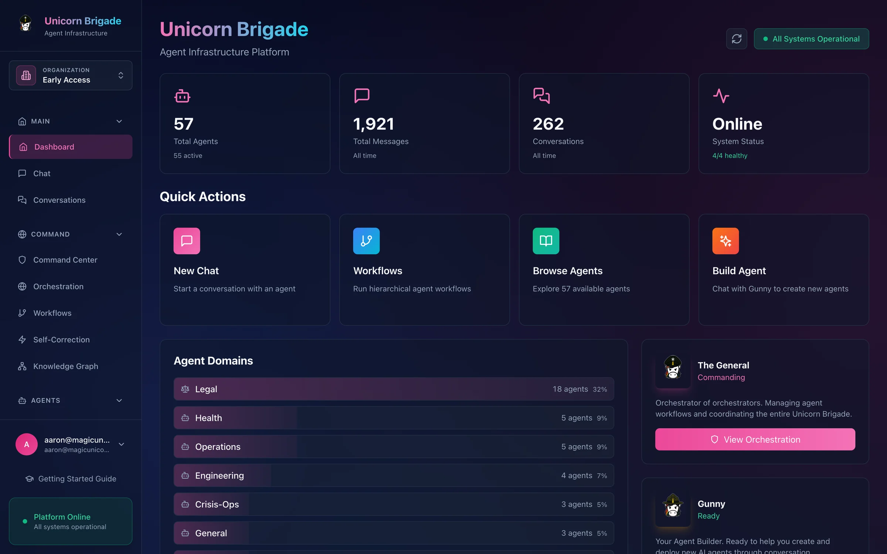
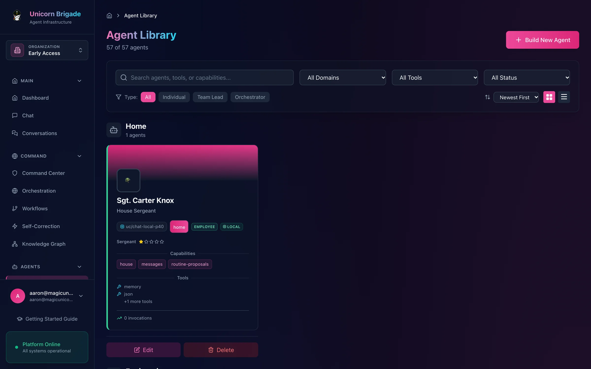
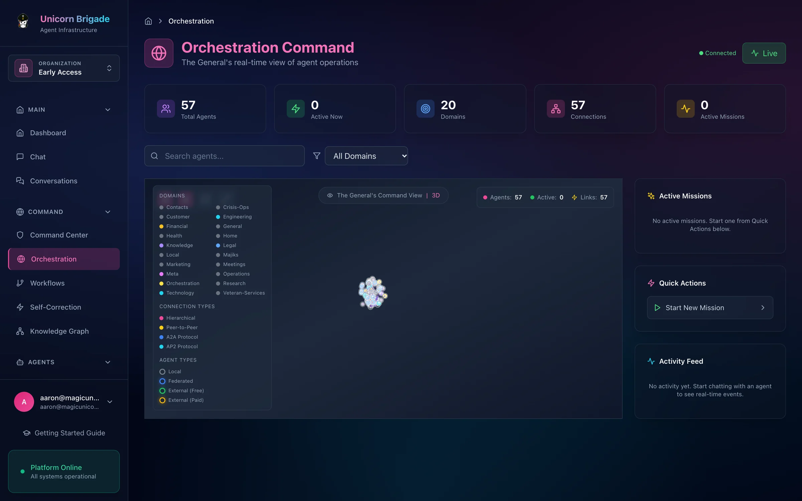
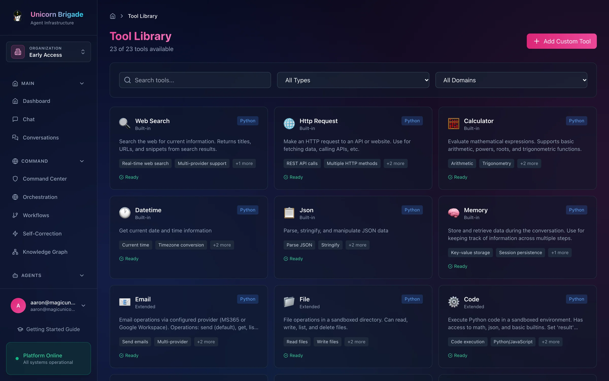
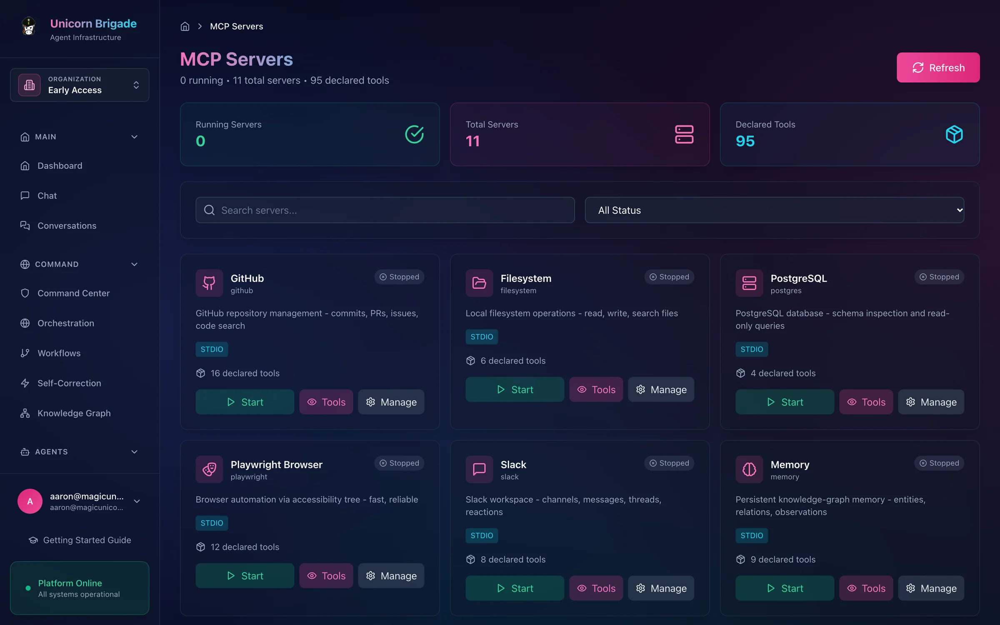

# Unicorn Brigade

**Build agents, give them tools, and coordinate their work from one command center.**

[Quick start](#quick-start) · [Features](#feature-tour) · [Agents](#built-for-agents) · [Architecture](#architecture) · [Suite](#part-of-unicorn-commander)

  
   
  <em>Dashboard — agent status, domains and quick actions.</em>

## What is Unicorn-Brigade?

Unicorn Brigade is a self-hosted workspace for building, running and coordinating AI
agents. It gives developers and operators an agent library, tool assignments, chat,
workflows and a live view of delegated work. Agents execute tasks; people configure
their access, review results and guide retries. As the agent layer of Unicorn Commander,
Brigade can use shared identity and call other suite apps through authenticated APIs.

## Highlights

- **Give each agent a job.** Configure its persona, model, tools and access policy,
  or use Gunny's conversational builder to draft a new agent.
- **Watch work happen.** Follow missions, agent delegation and tool activity through
  streamed events and an interactive graph.
- **Connect useful tools.** Assign search, document, browser and business tools to
  agents; manage external MCP servers from the same interface.
- **Reuse workflows.** Combine an orchestrator, domain leads and workers with
  configurable models; Ralph adds retries and mid-run guidance.
- **Ground conversations in memory.** Connect Graphiti and FalkorDB to retain
  extracted facts and relationships across conversations.
- **Bring your own client.** Discover agents through A2A-style routes, use the
  OpenAI-compatible chat adapter, or connect to the suite MCP gateway.
- **Own the deployment.** Run the API and UI yourself, with API keys, optional
  Keycloak SSO and caller-aware tool permissions.

## Feature tour

### An agent library you can shape

  

Browse agents by domain, inspect their profiles, and choose their models and tools.
Gunny helps draft agent configurations through chat. Agent definitions and conversation
history live in PostgreSQL, with JSON import and export for moving definitions.

<strong>Meet the default seed roster</strong>

The default seed file contains **17 agent definitions**. Seeding happens when the agent
table is empty; an existing deployment can have a different roster. These are starting
personas whose useful behavior depends on the configured models, tools and services.

| Agent | Starting specialty |
|---|---|
| The General | Planning and agent orchestration |
| Gunny | Conversational agent building |
| Sgt. Cipher | Cybersecurity research |
| Cpt. Fullstack | Software engineering |
| Maj. DevOps | Infrastructure and operations |
| Col. Finance | Financial analysis |
| Lt. TaxStrat | Tax strategy |
| Judge Advocate | Legal research and analysis |
| Doc MedResearch | Medical literature research |
| Detective Holmes | Investigation and open-source research |
| Prof. DataSci | Data science |
| Support Specialist | Customer support |
| Code Reviewer | Code review |
| SQL Analyst | Database questions and text-to-SQL |
| Sgt. Scribe | Meeting notes and documentation |
| Maj. LeadGen | Lead enrichment and scoring |
| Lt. DocAnalyst | Document analysis |

Each definition can carry its own system prompt, model, temperature, token limit,
tools, capabilities, reporting line and access policy. A persona is not a professional
qualification or a guarantee of correct advice.

Sources: [seed roster](app/data/seed_agents.json), [seed loader](app/db/init_db.py),
[agent API](app/api/agent_routes.py), [builder API](app/api/builder_routes.py).

### The General's orchestration view

  

The General accepts natural-language commands. `POST /api/v1/orchestration/command`
asks a model and, when the meta-agent is available, can create an agent from the
reply. Task assignment and mission execution go through tools, missions, and
workflows. The orchestration view subscribes to Server-Sent Events for mission
progress, tool calls and agent activity, with a Three.js graph for exploring
connections. A browser EventSource cannot set API-key headers, so the UI first
calls `POST /api/v1/orchestration/events/ticket`.

<strong>Workflows, model selection and Ralph retries</strong>

The hierarchy separates orchestration, domain leads and workers. Configure models at
each level through presets or explicit overrides, so a workflow can use different
models for planning and execution. Cost estimates depend on the selected models
and providers.

The enabled catalog has **26 templates**. Additional professional templates
remain in the source tree but are not imported. The enabled set covers:

| Area | Examples |
|---|---|
| Research | Competitive intelligence, literature review, news briefings |
| Engineering | Code review, technical documentation, API integration |
| Operations | Incident response, help-desk triage, support resolution |
| Content | Research and writing, localization, content distribution |
| Business | Sales pipelines, RFP responses, meeting intelligence |
| Analysis | Data reports, due diligence, risk assessment |
| Specialist review | Contract analysis, compliance audits, legal and medical document review |

Inspect required inputs and model choices before starting a template. The templates
include human-review checkpoint definitions and the engine exposes checkpoint hooks,
but the HTTP execution route does not currently install a blocking approval callback.
Treat outputs and external actions as requiring your own review process.

**Ralph** wraps workflow steps in an iterative execution loop. It records failures,
retries with error context, accepts guidance during a run and exposes progress and
results. Execution snapshots and guidance are persisted to PostgreSQL; the engine
also retains local state files. Recovery of a saved run does not imply that every
interrupted external action can safely be repeated.

For example, a research workflow can gather sources, draft a report and pass the result
back for review. Sending that report requires an assigned email tool and configured
provider credentials.

Continue with the [workflow templates](app/workflows/templates.py),
[model configuration guide](docs/MODEL_FLEXIBILITY_ARCHITECTURE.md),
[workflow walkthroughs](docs/PHASE1_WORKFLOWS_IMPLEMENTATION.md) and
[Ralph guide](docs/RALPH_SELF_CORRECTION.md). Executable request schemas are in
[hierarchical routes](app/api/hierarchical_routes.py) and
[Ralph routes](app/api/ralph_routes.py).

### Tools that turn a conversation into work

  

Browse tool definitions and assign the capabilities an agent needs.
The library spans research, files, documents, notifications and code execution;
provider-backed tools need their own credentials and runtime dependencies.

<strong>Built-in tool reference</strong>

The executable [tool resolver](app/llm/tool_resolver.py) is authoritative.
The [permission catalog](docs/TOOL_CATALOGUE.md) explains tool privilege levels;
check the resolver when a catalog entry and executable name differ.

| Tool | What the handler provides |
|---|---|
| `web_search` | Search through Serper, SearXNG, or Bright Data |
| `http_request` | HTTP requests with URL validation and bounded timeouts |
| `calculator` | Arithmetic through a restricted expression parser |
| `datetime` | Current date and time in a chosen timezone |
| `json` | JSON parsing, formatting and manipulation |
| `memory` | Process-local key-value scratch storage |
| `shell` | Commands through the Docker sandbox executor |
| `email` | Send through the selected provider. Read, list, and search work with Microsoft 365 and Google; Resend and SendGrid are send-only |
| `file` | File operations with path checks |
| `code` | Python execution with restricted builtins in the API process |
| `text` | Text transformations and pattern operations |
| `image` | Image generation through the OpenAI image API |
| `database` | Process-local key-value tables |
| `notify` | Slack or Discord webhooks, or log notifications |
| `qrcode` | A URL for an external QR-image service |
| `agentic_rag` | Retrieval and answer generation through the graph/RAG integration |
| `browser` | Browser tasks through browser-use, when installed |
| `code_sandbox`, `sandbox_session` | In-process Python with restricted builtins, and process-local session state |
| `screenshot` | Page captures through Playwright |
| `pdf_extract` | PDF text extraction |
| `doc_generate` | Template-based Markdown or HTML documents |
| `data_analyze` | Summary statistics and analysis of CSV or JSON data |
| `url_preview` | Page metadata and an optional Playwright screenshot |
| `kg_query`, `knowledge_store`, `knowledge_query` | Configured FalkorDB graph operations |
| `slack` | Slack operations with the configured token |
| `csv`, `rss`, `translate`, `weather`, `schedule`, `company` | CSV and RSS helpers, LibreTranslate, Open-Meteo forecasts, date arithmetic, and a Clearbit logo URL. Company name search does not call an external company API |
| `delegate_to_agent` | Ask another Brigade agent to perform a task |

The `memory` and `database` tools are temporary stores. Persistent conversation memory
is a separate Graphiti integration. Likewise, `code` and `code_sandbox` are not Docker
isolation boundaries; the `shell` handler explicitly uses the Docker sandbox.
See [Security](#security) before assigning execution tools.

Email integration includes Microsoft 365 and Google Workspace adapters, with Resend
and SendGrid configuration also present. Browser automation needs browser-use or
Playwright plus an installed browser. The base API image does not include those
browser packages or a Docker daemon for nested shell execution.

Sources: [core handlers](app/llm/builtin_tools.py),
[extended handlers](app/llm/extended_tools.py),
[advanced handlers](app/llm/advanced_tools.py).

<strong>Persistent memory, voice and code attribution</strong>

**Memory.** The application initializes Graphiti over FalkorDB. Conversation ingestion
extracts facts into a graph; retrieval brings relevant facts back into agent context.
Configure the graph connection, extraction model and embedding endpoint together.
The old `MEMORY_PROVIDER` setting does not switch the current application back to mem0.
Qdrant remains in the base Compose stack, but is not the active conversation-memory
backend.

Memory groups include user, agent and, where supplied, case context. Inspect the
[memory implementation](app/memory/graphiti_manager.py) and
[memory inspector routes](app/api/memory_inspector_routes.py) for grouping and retrieval.

**Voice.** LiveKit room APIs, participant tokens and frontend call controls provide
the voice interface. The optional deployment needs a LiveKit server and a separate
voice worker. The bundled worker accepts speech-to-text providers `deepgram`,
`whisper`, and `assemblyai`, and text-to-speech providers `elevenlabs`, `openai`,
and `cartesia`. Its `whisper` path calls the OpenAI `whisper-1` API. Additional
self-hosted provider implementations include MLX Whisper, faster-whisper,
whisper.cpp, Kokoro, Chatterbox, Marvis, CosyVoice and custom TTS.

Those implementations are not all selectable through the bundled worker:
its provider enums differ from the self-hosted settings defaults. Match the worker,
provider dependencies and hardware before enabling voice. Some providers offer voice
samples or cloning; availability depends on the adapter you deploy.

See [voice deployment](docker-compose.livekit.yml),
[worker](scripts/voice_agent_worker.py), [provider implementations](app/voice/providers/)
and [voice settings API](app/api/voice_settings_routes.py).

**Agent Trace.** Code-attribution records associate generated code with an agent,
model, prompt, file, line range and `code_hash` (the first 16 hex characters of a
SHA-256 of the whitespace-normalized code). Query recent records or one agent's
records, and export JSON or CSV. A PDF report request returns 501. This is useful
audit evidence; it does not establish regulatory compliance or prove that every
generated artifact was captured.

See the [Agent Trace guide](docs/AGENT_TRACE.md),
[API reference](docs/API_TRACE_QUICK_REFERENCE.md) and
[trace implementation](app/observability/agent_trace.py).

### MCP servers and tools

  

Start and stop external MCP servers, inspect their status, and discover their tools.
Brigade includes **11 server presets**; advertised capabilities are descriptions,
while connected servers supply their actual tool lists at runtime.

<strong>External MCP server presets</strong>

| Preset | Configuration or runtime needed | Intended use |
|---|---|---|
| GitHub | `GITHUB_TOKEN` | Repositories, issues and pull requests |
| Filesystem | `WORKSPACE_PATH` | Scoped file access |
| PostgreSQL | `DATABASE_URL` | Read-only queries and schema inspection |
| Playwright | Browser runtime | Browser navigation and interaction |
| Slack | `SLACK_BOT_TOKEN`, `SLACK_TEAM_ID` | Channels, messages and reactions |
| Memory | Writable storage | Knowledge-graph entities and observations |
| Brave Search | `BRAVE_API_KEY` | Web search |
| Google Drive | `GDRIVE_CREDENTIALS_PATH` | File search and resources |
| Puppeteer | Browser runtime | Browser control and screenshots |
| Stripe | `STRIPE_API_KEY` | Payment and billing operations |
| Notion | `NOTION_API_KEY` | Pages, databases and search |

These are configurations in [the registry](app/mcp/registry.py), not services started
by the base Compose file. The presets launch through `npx`, which must be installed
in the backend's execution environment; the current base API Dockerfile does not
install it. Package availability, credentials and browser dependencies must be checked
when provisioning each server.

The bundled MCP client implements STDIO subprocess and HTTP connections. The
[registry API](app/api/mcp_registry_routes.py) supports registering additional
servers and controlling their lifecycle. Its administration paths require an admin
credential.

## Built for agents

Brigade exposes agent chat, an internal tool API and a federation gateway.
Choose the surface that matches the client you are connecting.

### Connect an MCP client to the suite gateway

`POST /mcp` accepts MCP JSON-RPC over HTTP and returns JSON responses.
It supports initialization, tool discovery and tool calls. Authenticate with
`X-API-Key: <brigade-api-key>`, or with `Authorization: Bearer <brigade-api-key>`
when that key contains fewer than two dots. A bearer value with two or more dots
is accepted only as a Keycloak JWT.

For an MCP client that accepts HTTP server entries:

~~~json
{
  "mcpServers": {
    "unicorn-brigade": {
      "type": "http",
      "url": "https://<brigade-host>/mcp",
      "headers": {
        "Authorization": "Bearer <brigade-api-key>"
      }
    }
  }
}
~~~

The gateway lists tools from **registered federated apps**, filtered by the caller's
tier and key permissions. Its tool count depends on those registrations; a fresh
standalone instance has no federated app tools until an administrator registers them.
It does not automatically export the internal tool catalog.

Calls are forwarded with a signed, short-lived token carrying the caller's identity.
Federation needs an RSA signing-key configuration and cooperating upstream apps.
See the [gateway](app/federation/mcp_gateway.py),
[registration API](app/federation/registration_routes.py) and
[key-management guide](docs/federation-key-rotation.md).

### Use Brigade's internal tool catalog

The internal catalog has **70 unconditional tool entries** in the source, including
proxied integrations. Optional environment-gated integrations can add entries.
Registration describes available handlers; execution still requires the relevant
service, credentials and dependencies.

Useful entry points include `web_search`, `calculator`, `doc_generate`,
`data_analyze`, `delegate_to_agent`, `list_my_tasks`, `get_project`,
`canvas_create` and `search_knowledge`.

| Endpoint | Authentication and purpose |
|---|---|
| `GET /api/v1/mcp/info` | Authenticated server info and current tool count |
| `GET /api/v1/mcp/tools/list` | Authenticated tool catalog |
| `GET /api/v1/mcp/tools/openai` | Authenticated function-calling schemas |
| `GET /api/v1/mcp/tools/anthropic` | Authenticated tool-use schemas |
| `POST /api/v1/mcp/tools/call` | Admin-only direct tool execution |
| `GET /api/v1/mcp/resources/list` | Authenticated resource catalog |
| `POST /api/v1/mcp/request` | Admin-only legacy method/params dispatcher |
| `GET /api/v1/mcp/config` | Authenticated legacy client-configuration helper |

~~~bash
curl --fail-with-body http://localhost:8100/api/v1/mcp/tools/list \
  -H 'X-API-Key: <brigade-admin-key>'

curl --fail-with-body http://localhost:8100/api/v1/mcp/tools/call \
  -H 'X-API-Key: <brigade-admin-key>' \
  -H 'Content-Type: application/json' \
  -d '{"name":"calculator","arguments":{"expression":"12 * 7"}}'
~~~

The legacy `/api/v1/mcp/request` endpoint dispatches method/params requests without
the full JSON-RPC handshake at `/mcp`. Its resource manager has file and HTTP(S)
backends; other URI schemes need a registered backend. The existing
[One-Key MCP guide](docs/one-key-mcp.md)
covers that legacy surface; its public-discovery descriptions predate the current
authentication requirements. Follow the table above and [current routes](app/api/mcp_routes.py).

### Agent chat and delegation hooks

| Surface | What you can do |
|---|---|
| `GET /api/v1/a2a/agents` | List agent cards. This handler has no credential dependency |
| `GET /api/v1/a2a/agents/{agent_id}/card` | Read one agent card. This handler has no credential dependency |
| `POST /api/v1/a2a/discover` | Filter by capability, domain, query, or tags. This handler has no credential dependency |
| `POST /api/v1/a2a/agents/{agent_id}/invoke` | Invoke an agent with an operator credential |
| `POST /api/v1/agents/{agent_id}/chat` | Chat with an agent and run its assigned tools |
| `GET /api/v1/openai/v1/models` | Discover accessible agents as model IDs |
| `POST /api/v1/openai/v1/chat/completions` | Use an OpenAI-compatible client, including streaming |
| `GET /api/v1/orchestration/events` | Subscribe to authenticated mission and tool events |

The [OpenAI-compatible adapter](docs/openai-compat.md) applies the selected agent's
persona and server-side tool loop. It also supports client-supplied tools and per-call
model overrides. The [A2A implementation](app/api/a2a_routes.py) defines Brigade's
discovery and invocation schema.

For suite consumers that forward a human end user, [caller authorization](docs/CALLER_AUTHORIZATION.md)
covers per-agent access policies and per-caller tool privilege checks. Stable room
context is injected by the server for room canvas and knowledge tools.

## Quick start

**Local evaluation with Docker Compose.** You need Docker with Compose, available local
ports, and model credentials to run agent chat. Keycloak and Ops-Center are optional
for this path: it uses the application's development authentication mode.

The checked-in frontend container serves static files and assumes an external API
proxy. The override below gives it an explicit local API URL, enables development
auth, and binds the stack to loopback. Use a Compose release that supports
`!override` when merging port lists.

### Prepare your configuration

From a checkout of this repository:

~~~bash
cp .env.example .env
~~~

Edit `.env` before starting:

- Replace `POSTGRES_PASSWORD` and `REDIS_PASSWORD` with distinct URL-safe passwords.
- Replace `BRIGADE_ADMIN_KEY` with a private value.
- Supply `OPENAI_API_KEY` for direct OpenAI model calls, or configure
  `UC_GATEWAY_URL` and `UC_GATEWAY_KEY` for your own compatible gateway.
  Remove example provider credentials you are not using.
- Review the example's deployment-specific service addresses. Persistent graph memory,
  voice, browser tools and external integrations need additional setup described below.

The base stack is sufficient for the UI, PostgreSQL-backed agent definitions and chat
with a configured model. It does not provision a model server or the graph-memory,
voice and external MCP runtimes.

### Start the local stack

~~~bash
docker compose -f docker-compose.yml -f - up -d --build <<'YAML'
services:
  brigade-api:
    environment:
      ENVIRONMENT: development
      AUTH_BYPASS: "true"
      BRIGADE_USE_KEYCLOAK: "false"
      LANGFUSE_ENABLED: "false"
      CORS_ORIGINS: http://localhost:3000,http://localhost:5173
    ports: !override
      - "127.0.0.1:8100:8100"
  brigade-frontend:
    build:
      args:
        VITE_API_URL: http://localhost:8100/api/v1
        VITE_DEV_MODE: "true"
    ports: !override
      - "127.0.0.1:3000:80"
  brigade-postgres:
    ports: !override
      - "127.0.0.1:5432:5432"
  brigade-redis:
    ports: !override
      - "127.0.0.1:6379:6379"
  brigade-qdrant:
    ports: !override
      - "127.0.0.1:6333:6333"
      - "127.0.0.1:6334:6334"
YAML
~~~

The API creates tables, applies additive migrations and seeds the default roster on
startup. Wait for startup to finish, then check readiness and agent discovery:

~~~bash
docker compose logs --tail=100 brigade-api
curl --fail http://localhost:8100/readyz
curl --fail http://localhost:8100/api/v1/agents
~~~

Open the [dashboard](http://localhost:3000/dashboard).
Interactive [API documentation](http://localhost:8100/docs) is enabled in development.

Choose an agent in the library and set its model to one served by your configured
provider. Seeded agents keep the model id from the seed file. `OPENAI_MODEL` does
not rewrite existing agent definitions. The OpenAI-compatible routes always
require an API key; development auth bypass does not apply to them. For an API
smoke test with your own OpenAI model ID:

~~~bash
curl --fail-with-body http://localhost:8100/api/v1/openai/v1/chat/completions \
  -H 'X-API-Key: <brigade-admin-key>' \
  -H 'Content-Type: application/json' \
  -d '{
    "model": "the-general",
    "model_override": "<openai-model-id>",
    "messages": [{"role": "user", "content": "Reply with a short greeting."}]
  }'
~~~

Development authentication bypasses login. Keep this setup local. For shared hosting,
disable bypass, rebuild the UI without development mode, provide an API reverse proxy,
and configure API-key access or [Keycloak SSO](docs/self-host-sso.md).

### Stop and troubleshoot

~~~bash
docker compose ps
docker compose logs --tail=100 brigade-api
docker compose down
~~~

`down` retains the named data volumes. Reuse the override block when rebuilding or
recreating the local stack; plain `docker compose up` restores the base production
settings. The API's `/livez` checks process liveness, while `/readyz` checks application
readiness. A loaded frontend alone does not establish that the API or models work.

If the UI loads but data is missing, check API readiness and the frontend build
arguments. If chat fails, confirm the agent's model ID and provider route.
Missing graph memory or voice is expected until those services are configured.

## Run from source

Use Python 3.11, the version in the [API image](Dockerfile) and [CI guide](docs/CI.md),
and Node 20, the version in [the frontend image](frontend/Dockerfile). From the
repository root, create `.env` as above and start the datastore services:

~~~bash
docker compose up -d brigade-postgres brigade-redis brigade-qdrant
python3 -m venv .venv
source .venv/bin/activate
python -m pip install -r requirements-prod.txt
~~~

For a backend running on the host, edit `.env` so `DATABASE_URL` uses your local
PostgreSQL connection in this form:

~~~dotenv
DATABASE_URL=postgresql+asyncpg://<database-user>:<database-password>@localhost:5432/<database-name>
~~~

Also point `POSTGRES_HOST` and `REDIS_HOST` at `localhost` and `QDRANT_URL` at
`http://localhost:6333`. Set `ENVIRONMENT=development` and `AUTH_BYPASS=true` for local
evaluation, and `LANGFUSE_ENABLED=false` unless you configured Langfuse.
Pass `--env-file` so settings are loaded before application modules import:

~~~bash
python -m uvicorn app.main:app --env-file .env --reload --host 127.0.0.1 --port 8100
~~~

In another terminal:

~~~bash
cd frontend
npm ci
VITE_DEV_MODE=true npm run dev -- --host 127.0.0.1
~~~

Open [the development UI](http://localhost:5173/dashboard).
Vite proxies `/api` requests to the local backend.
`requirements-prod.txt` is the core dependency set used by CI and Docker;
[requirements.txt](requirements.txt) additionally includes development, browser and
voice packages. Graphiti is layered separately in the [API Dockerfile](Dockerfile);
install and configure optional dependencies for the features you need.

## Configuration

[.env.example](.env.example) is the variable inventory. It contains example credentials
and deployment-specific defaults, so review it before use. Keep real credentials in
your local environment or secret manager.

| Variable | Meaning |
|---|---|
| `ENVIRONMENT` | Runtime environment and production safety checks |
| `BRIGADE_ADMIN_KEY` | Bootstrap API credential with administrator access |
| `AUTH_BYPASS` | Development-only authentication bypass |
| `CORS_ORIGINS` | Allowed browser origins |
| `BRIGADE_USE_KEYCLOAK` | Enable OIDC bearer validation and SSO |
| `OIDC_ISSUER`, `KEYCLOAK_CLIENT_ID` | Identity-provider realm and client |
| `KEYCLOAK_CLIENT_SECRET` | Confidential-client credential for browser login |
| `BRIGADE_CALLBACK_URL`, `BRIGADE_FRONTEND_URL` | Browser-login callback and frontend destination |
| `BRIGADE_ALLOWED_EMAILS` | Optional identity allowlist |
| `DATABASE_URL` | Runtime PostgreSQL connection; documented in the example's role-split notes |
| `MIGRATION_DATABASE_URL` | Owner connection for migrations and role provisioning |
| `POSTGRES_HOST`, `POSTGRES_PORT`, `POSTGRES_USER`, `POSTGRES_PASSWORD`, `POSTGRES_DB` | PostgreSQL service settings used by Compose |
| `REDIS_HOST`, `REDIS_PORT`, `REDIS_PASSWORD` | Redis connection settings |
| `QDRANT_URL` | Address of the base-stack Qdrant service; monitoring reads it |
| `QDRANT_COLLECTION` | Name present in `.env.example`; application code does not read it |
| `OPENAI_API_KEY` | Credential for direct OpenAI-model and image calls |
| `UC_GATEWAY_URL`, `UC_GATEWAY_KEY` | Compatible model-gateway endpoint and credential |
| `UC_GATEWAY_PER_ORG_KEYS_ENABLED`, `UC_GATEWAY_ORG_KEYS_JSON` | Optional per-organization gateway-key mapping |
| `FALKORDB_HOST`, `FALKORDB_PORT`, `FALKORDB_PASSWORD`, `FALKORDB_DATABASE` | Graphiti graph connection |
| `MEMORY_LLM_BASE_URL`, `MEMORY_LLM_MODEL` | Model endpoint and model for memory extraction |
| `MEMORY_EMBED_BASE_URL`, `MEMORY_EMBED_MODEL`, `MEMORY_EMBED_DIMS` | Memory embedding endpoint, model and dimensions |
| `LANGFUSE_ENABLED`, `LANGFUSE_HOST`, `LANGFUSE_PUBLIC_KEY`, `LANGFUSE_SECRET_KEY` | Optional LLM tracing |
| `LIVEKIT_URL`, `LIVEKIT_API_KEY`, `LIVEKIT_API_SECRET` | Voice-room connection and signing credentials |
| `VOICE_STT_PROVIDER`, `VOICE_TTS_PROVIDER` | Speech provider selections; match the worker implementation |
| `EMAIL_PROVIDER` | Email adapter selection |
| `MS365_CLIENT_ID`, `MS365_TENANT_ID`, `MS365_CLIENT_SECRET`, `MS365_USER_EMAIL` | Microsoft email credentials and sending identity |
| `GOOGLE_CLIENT_ID`, `GOOGLE_CLIENT_SECRET`, `GOOGLE_REFRESH_TOKEN`, `GOOGLE_USER_EMAIL` | Google email authorization and identity |
| `BROWSER_USE_ENABLED` | Optional browser automation setting |
| `CODE_SANDBOX_ENABLED` | Enable the restricted Python execution handler |
| `SANDBOX_NETWORK_ENABLED`, `SANDBOX_MAX_MEMORY`, `SANDBOX_MAX_CPU` | Docker sandbox resource and network policy |
| `KNOWLEDGE_OPS_URL`, `KNOWLEDGE_OPS_TOKEN` | Direct Knowledge-Ops endpoint and fallback credential |
| `KNOWLEDGE_OPS_OIDC_TOKEN_URL`, `KNOWLEDGE_OPS_OIDC_CLIENT_ID`, `KNOWLEDGE_OPS_OIDC_CLIENT_SECRET` | Preferred client-credentials authentication for direct knowledge tools |
| `LOG_LEVEL` | Application log verbosity |

Additional flags live in [runtime configuration](app/config/features.py).
The model router supports direct OpenAI calls, explicit OpenRouter model routes,
local model endpoints and the configured UC gateway/Ops-Center path. Anthropic
model names use the gateway route when configured. See the
[router implementation](app/llm/ops_center_client.py) for model-prefix selection;
an API key alone does not change an agent's stored model.

`BRIGADE_FEDERATION_ONLY` leaves the federation surface mounted and skips the
internal routers and their startup initialization. `BRIGADE_INTERNAL_AGENTS_ENABLED`
controls whether startup seeds internal agents; it defaults to on unless
federation-only mode is set. For shared deployments, the database role split
matters: the base
Compose file uses a database owner connection, which bypasses row-level security.
Override the runtime DSN and supply a separate migration DSN before relying on tenant
isolation.

<strong>Optional services and deployment notes</strong>

| Capability | Existing configuration | Additional setup |
|---|---|---|
| Persistent graph memory | [FalkorDB Compose](docker-compose.falkordb.yml) | Extraction and embedding endpoints reachable from the API |
| Voice rooms and worker | [LiveKit Compose](docker-compose.livekit.yml) | LiveKit config, credentials and compatible worker providers |
| LLM tracing | [Langfuse Compose](docker-compose.langfuse.yml) | Service keys, backing services and API-reachable host URL |
| Metrics dashboards | [Observability Compose](docker-compose.observability.yml) | Prometheus/Grafana configuration and access controls |
| Visual flow integration | [Langflow Compose](docker-compose.langflow.yml) | Langflow service, database and API configuration |
| Browser and sandbox services | [MCP Compose](docker-compose.mcp.yml) | Runtime-specific browser/sandbox wiring |
| Optional content scanning | [Guardrails Compose](docker-compose.guardrails.yml) | Explicit service deployment and application integration |

These files are starting configurations, not a single combined turnkey stack.
In the FalkorDB overlay, the API port must be corrected to `6379` for container-to-container
traffic; `6380` is the published host port. Set the memory-model URLs explicitly.
The current Graphiti client uses a fixed placeholder credential for its model clients,
so authenticated memory endpoints need a compatible access arrangement.

The LiveKit overlay declares an external network; provision or adapt that network and
its mounted server configuration before use. The example's self-hosted voice provider
defaults are not accepted by the bundled cloud-provider worker.

The MCP registry's Node runtime, browser executables and Docker sandbox access are
separate requirements. Do not assume a Compose service grants another service access
to its binaries or Docker daemon.

For remote execution, consult [the existing guide](docs/REMOTE_EXECUTION.md).
Use your own hosts and credentials when adapting deployment examples in older docs.

## Architecture

~~~mermaid
flowchart TD
    Human["Human operator"] --> UI["React / Vite interface"]
    UI -->|"HTTP + streamed events"| API["FastAPI"]
    Client["Agent client"] -->|"Chat / A2A / tool API"| API
    Client -->|"MCP JSON-RPC"| Gateway["Federation gateway"]
    API --> Auth["API keys / optional Keycloak"]
    Gateway --> Auth
    API --> Agents["Agent profiles + tool execution"]
    API --> Workflows["Hierarchical workflows + Ralph"]
    Agents --> Models["Model router"]
    Workflows --> Models
    Models --> Providers["Configured providers / Ops-Center gateway"]
    API --> DB[("PostgreSQL")]
    Workflows --> DB
    Agents --> Memory["Graphiti memory"]
    Memory --> Graph[("FalkorDB")]
    Memory --> Embed["Extraction + embedding endpoints"]
    Agents --> Tools["Built-in tools / external MCP servers"]
    Gateway --> Apps["Registered suite apps"]
    Agents --> Trace["Agent Trace / optional Langfuse"]
    UI --> Voice["Optional LiveKit rooms"]
    Voice --> Worker["Voice worker + STT/TTS"]
~~~

- **Interface:** React 18.3, Vite 5 and Tailwind 3.4, with Three.js/react-force-graph
  for agent visualization and React Flow for workflow views. The frontend image
  builds on Node 20.
- **API:** FastAPI 0.115.0 on Python 3.11, with routes for agents, tools,
  conversations, workflows and integration adapters; an event bus streams
  orchestration activity.
- **Execution:** Per-agent model/tool configuration, a model router, hierarchical
  workflow engine, Ralph retry engine and scheduled-run service.
- **State:** PostgreSQL 16 stores application records and execution snapshots.
  Graphiti/FalkorDB handles configured conversation memory. The base Compose stack
  also provisions Redis 7.4 and Qdrant 1.12.0.
- **Agent interfaces:** A2A-style discovery, the OpenAI-compatible adapter, internal
  tool dispatch and a separate federation MCP gateway.
- **Optional services:** External MCP servers, LiveKit, Langflow, Langfuse and
  observability services require their own deployment and credentials.

<strong>Source map and API reference</strong>

| Component | Source or reference |
|---|---|
| Startup, middleware and mounted routes | [app/main.py](app/main.py) |
| Agent records, chat and tool assignments | [app/api/agent_routes.py](app/api/agent_routes.py) |
| Model routing | [app/llm/ops_center_client.py](app/llm/ops_center_client.py) |
| Mission events and SSE | [app/orchestration/](app/orchestration/) |
| Workflow templates, engine and retries | [app/workflows/](app/workflows/) |
| Scheduled execution | [app/services/scheduler.py](app/services/scheduler.py) |
| Tenant-aware persistence and migrations | [app/db/](app/db/) |
| Federation and delegated credentials | [app/federation/](app/federation/) |
| Memory | [app/memory/](app/memory/) |
| Trace and metrics | [app/observability/](app/observability/) |

Common HTTP operations, in addition to the agent endpoints above:

| Method and route | Purpose |
|---|---|
| `POST /api/v1/orchestration/command` | Send a command to The General |
| `GET /api/v1/orchestration/state` | Read visible missions and current activity |
| `POST /api/v1/hierarchical/execute` | Execute a configured workflow template |
| `POST /api/v1/ralph/execute` | Start a retry-enabled workflow |
| `POST /api/v1/ralph/executions/{execution_id}/guidance` | Supply additional execution context |
| `POST /api/v1/voice/rooms` | Create a configured voice room |
| `GET /api/v1/voice/rooms/{room_id}/token` | Obtain a participant token |
| `GET /api/v1/trace/recent` | Query recorded code attributions |
| `GET /api/v1/trace/agents/{agent_id}` | Query attributions recorded for one agent |
| `POST /api/v1/trace/report` | Export JSON or CSV attribution reports. PDF returns 501 |

Use the development server's [Swagger UI](http://localhost:8100/docs) for current
request and response schemas. Interactive docs are hidden by default in production;
the code supports an explicit `EXPOSE_API_DOCS` override.

The repository also retains [UCP commerce/session models](app/protocols/ucp.py).
They are not mounted as the `/api/v1/ucp/*` endpoints previously advertised in this
README. Current billing and usage integration lives in
[app/integrations/](app/integrations/) and [billing routes](app/api/billing_routes.py).

## Part of Unicorn Commander

| App | What it does |
|---|---|
| Ops-Center | Model routing and subscription lookup used by this API. No public repository under that name was listed |
| **Unicorn-Brigade** | **This repository: agents, tools, memory, orchestration** |
| [Unicorn Stable](https://github.com/Unicorn-Commander/Unicorn-Stable) | Humans and agents in the same room |
| [Accounting-Ops](https://github.com/Unicorn-Commander/Accounting-Ops) | Agent-native double-entry books |
| [Contact-Ops](https://github.com/Unicorn-Commander/Contact-Ops) | The shared contact and identity layer |
| [Customer-Ops](https://github.com/Unicorn-Commander/Customer-Ops) | Customer relationships and pipeline |
| [Email-Ops](https://github.com/Unicorn-Commander/Email-Ops) | Agent-governed email with a human approval inbox |
| [Project-Ops](https://github.com/Unicorn-Commander/Project-Ops) | Projects, tasks, and billing fields |
| [Meeting-Ops](https://github.com/Unicorn-Commander/Meeting-Ops) | Record, transcribe, and search meetings |
| Knowledge-Ops | Document search and grounding. No public repository under that name was listed |

Brigade connects to Ops-Center for model routing and billing, shares Keycloak identity
when configured, exposes Project-Ops tools, uses Stable room canvas/knowledge APIs, and
can discover selected Accounting-Ops, Customer-Ops and Knowledge-Ops tools through its
[sibling-app adapters](docs/SIBLING_APP_TOOLS.md).

## Development

Start with [CONTRIBUTING.md](CONTRIBUTING.md) and the setup above.
After installing the core dependencies, install the test and lint tools:

~~~bash
python -m pip install pytest==8.3.3 pytest-asyncio==0.24.0 pytest-cov==5.0.0 \
  respx==0.22.0 ruff==0.7.0 mypy==1.13.0
python -m pytest
ruff check --select E9,F63,F7 app tests
make lint
~~~

`pytest.ini` includes both `tests/` and `app/tests/`. Some suites need PostgreSQL or
optional integrations; configure those services before running their tests.
Wall-clock performance benchmarks are excluded from the default run. The full
`make lint` target runs Ruff and mypy and may report the existing backlog; the smaller
Ruff selection above matches the repository's syntax/error gate.

~~~bash
cd frontend
npm ci
npm run build
~~~

The frontend package defines development, build and preview commands; it has no
dedicated test or lint script. The existing [CI guide](docs/CI.md) explains the check
policy. Its deployment examples and the older contributor setup should be adapted
to your environment; the current startup path is above.

Project history is retained in the [changelog](CHANGELOG.md).
The [roadmap](docs/2026-ROADMAP.md) records earlier plans, not a current delivery
promise. For questions, use [the documentation directory](docs/),
[Getting Started](docs/GETTING_STARTED.md),
or [support@magicunicorn.tech](mailto:support@magicunicorn.tech).

## Security

Report vulnerabilities privately through [SECURITY.md](SECURITY.md) or
[security@unicorncommander.ai](mailto:security@unicorncommander.ai).
Include the affected commit, reproduction steps and relevant redacted logs.

Authentication supports API keys and optional OIDC. Admin, Operator and Viewer roles,
per-agent tool assignments and caller-level tool checks constrain protected paths.
The application rejects production configurations that enable development auth bypass.

Review the execution boundary of each tool: `shell` uses Docker, while the Python
`code` and `code_sandbox` handlers execute inside the API process with restricted
builtins. External MCP presets normally launch subprocesses; they are not inherently
isolated containers. Direct admin MCP tool calls are not a human-approval queue.

For shared deployments, verify database role separation and row-level-security
enforcement, configured identity policies and upstream credentials. The current source
includes rate limiting and request-size controls; older security and setup documents
may describe earlier gaps. Optional guardrail configurations do not mean that every
model or tool call is scanned.

## Licence

Unicorn Brigade is licensed under [Apache-2.0](LICENSE). Our names and logos are covered by [TRADEMARKS.md](TRADEMARKS.md).
A project by Magic Unicorn Unconventional Technology & Stuff Inc.; copyright and
licence terms are provided in the existing licence file.

Built by [Magic Unicorn](https://magicunicorn.tech) · part of [Unicorn Commander](https://unicorncommander.ai)
